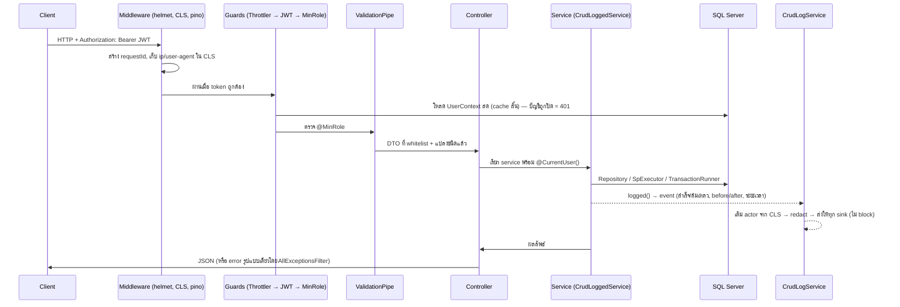

# สถาปัตยกรรม

## 1. หลักการ

| หลักการ | รายละเอียด |
|---|---|
| **Modular monolith** | แยก service ตาม module ชัดเจน (`auth`, `shared`, `dms`, `kms`, `rgp`, `wfe`) อยู่ใน deployable เดียว — module สื่อสารกันผ่าน provider ที่ export หรือ "port" (token + interface) ไม่ import class ภายในของกัน · ถ้าจะแยกเป็น microservice ภายหลัง เส้นแบ่งคือขอบ module เหล่านี้ |
| **Thin controller / fat service** | controller = HTTP เท่านั้น · กฎธุรกิจอยู่ใน service · SQL อยู่ใน service/repository (ไม่อยู่ใน controller) — มีเทสต์ตรวจ |
| **ยึด DB จริง** | entity และ SP catalog สร้างจาก DDL/SP ที่ export (`npm run codegen`) ไม่เขียนมือ → ชื่อ/ชนิดคอลัมน์ตรงกับ DB เสมอ |
| **Fail fast** | env ผิดแอปไม่ขึ้น (zod) · DI ผิดแอปไม่ขึ้น (เทสต์ e2e ตรวจ) · SP param ผิดชนิด compile ไม่ผ่าน |
| **ปลอดภัยเป็นค่าเริ่มต้น** | ทุก endpoint ต้อง login (global guard) · whitelist ทุก DTO · parameterized SQL · redact ความลับใน log · ตอบ 5xx แบบไม่รั่วรายละเอียด |

## 2. โครงโฟลเดอร์

```
src/
  main.ts · app.module.ts · app.setup.ts (ตั้งค่า pipe/filter/swagger ที่ใช้ร่วมกับเทสต์) · swagger.ts
  config/            env schema (zod) + AppConfigService (typed)
  common/            enums, UserContext, exceptions, filters, guards, decorators, DTO กลาง (paging), utils, EntityCrudService
  core/              cls (request context) · crud-log · logging (pino) · cache
  database/          DatabaseModule (หลาย DataSource), SpExecutor, TransactionRunner, entities.generated, sp/ (catalog + executor)
  health/            liveness / readiness
  modules/
    auth/            AD proxy, JWT, UserContextService, guards ตัวแรก
    shared/ dms/ kms/ rgp/ wfe/    ← แต่ละ module: entities/ (generated) + <feature>/{dto,service,controller} + <module>.module.ts
tools/codegen/       ตัวสร้าง entity และ SP catalog จาก docs/reference/db-export
test/                unit/ · e2e/ (wiring) · architecture/ (บังคับกติกา) · helpers/
docs/                คู่มือ + reference/ (เอกสารระบบเดิม + DDL export)
```

## 3. วงจรของ 1 คำขอ



## 4. การเชื่อมต่อ SQL Server

| เรื่อง | การทำงาน |
|---|---|
| DataSource | `CMS_DB` (ค่าเริ่มต้น: `@InjectRepository(E)`) และ `BUI_RG` ชื่อ `'project'` (`@InjectRepository(E, 'project')`) — ใช้ server/ผู้ใช้เดียวกันได้ถ้าไม่ตั้ง `PROJECT_DB_*` |
| ไดรเวอร์ | `mssql` (tedious) ผ่าน TypeORM · `encrypt`/`trustServerCertificate` ตั้งจาก env · pool/timeout ตั้งจาก env |
| เวลา | DB เก็บเวลาท้องถิ่น (`GETDATE()`) → `useUTC:false` + `TZ=Asia/Bangkok` (ตั้งใน `main.ts`, Dockerfile, เทสต์) |
| Entity | สร้างจาก DDL (63 ตาราง) **ไม่มี relation/navigation** — join ทำใน QueryBuilder/SQL ตรง เพื่อหลีกเลี่ยง circular import และให้ query ชัดเจน · bigint → `string` · rowversion → `@Exclude` |
| Stored Procedure | `Sp.<schema>.<name>` ชนิดพารามิเตอร์มาจากนิยามจริง (124 ตัว) · `SpExecutor` ใช้ mssql ตรงเพราะ TypeORM `query()` คืนแค่ recordset แรกและไม่รองรับ OUTPUT · ลองใหม่เมื่อ deadlock (1205) นอก transaction · `RAISERROR/THROW` เลข ≥ 50000 → 422 พร้อมข้อความของ SP |
| Transaction | `TransactionRunner.run(({ manager, sp }) => …)` — ทั้ง entity และ SP อยู่ใน transaction เดียวกัน (`sp` ส่งต่อเป็น option) |
| Schema | `synchronize` ปิดเสมอ (บังคับด้วย env schema ใน production) — การเปลี่ยน schema ผ่านสคริปต์ของ DBA (ตัวอย่างข้อเสนอ: [`docs/db/`](db)) |

### เมื่อ DB เปลี่ยน
1. export DDL/SP ใหม่ลง `docs/reference/db-export/` (รูปแบบเดิม) → 2. `npm run codegen` → 3. `git diff` ดูว่า entity/SP ใดเปลี่ยน แล้วแก้ service ที่ได้รับผลกระทบ (typecheck จะชี้ให้เมื่อ SP เปลี่ยนพารามิเตอร์) → 4. ตารางที่ไม่มี DDL ใน export กำหนดคอลัมน์เองที่ `tools/codegen/tables.config.ts`

## 5. Auth

- ผู้ใช้ล็อกอินผ่าน `POST /api/v1/auth/login` → API ส่งต่อให้ **AD Auth API เดิม** (`AD_AUTH_BASE_URL`) ตรวจ → ค้น/สร้าง `EMS.UserAccount` (ผู้ใช้ใหม่ = Officer, ยังไม่ให้ความยินยอม PDPA — พฤติกรรมเดิม) → sync ข้อมูลพนักงาน → ออก **JWT ของ API** (อายุ `JWT_EXPIRES_IN`) · `POST /auth/exchange` แลก AD access token (SSO) เป็น JWT
- JWT เก็บเพียง `sub`, `role`, `sid` — ข้อมูลผู้ใช้และสิทธิ์ตามชั้นความลับ (`EMS.sp_ResolveFolderAuthority`) โหลดสดทุกคำขอ (cache `CACHE_TTL_SEC` วินาที) → ปิดบัญชี/เปลี่ยนบทบาทมีผลภายในเวลานี้
- สิทธิ์ 3 ชั้น: (1) `@MinRole` ตาม AppRole 1–4 (2) `PermissionEvaluator` ตรวจ ACL ของโฟลเดอร์ (Deny ชนะ, สืบทอดจาก parent, Manager/Admin ผ่านเว้น Deny) (3) Authority ตามชั้นความลับ (HC/SC/NC/PC)

## 6. ข้อจำกัดที่ต้องรู้ (single instance)

ส่วนต่อไปนี้ออกแบบสำหรับ **instance เดียว**; ถ้าจะรันหลาย instance ต้องแก้ตามข้อแนะนำ P0/P1 ใน [RECOMMENDATIONS](RECOMMENDATIONS.md):
cache ในหน่วยความจำ (UserContext, SystemConfig) · งาน `@Cron` (escalation, SLA, purge ถังขยะ) ไม่มี distributed lock · งาน import KMS เก็บสถานะใน memory
